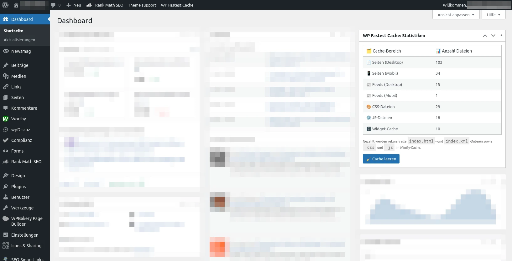

# WPFC Cache Stats Dashboard

A small WordPress plugin that shows cache statistics from [WP Fastest Cache](https://wordpress.org/plugins/wp-fastest-cache/) right in the admin dashboard. It answers one question: **how much can the server deliver without WordPress having to build a page again?**



The plugin's interface is in German. The labels quoted below are the ones you will see in WordPress, with an English explanation.

## Features

### Dashboard widget

- **Cache coverage:** share of published posts in the page cache, shown as a bar, plus pages, categories, tags, the front page and paginated archives.
- **History:** post coverage over the last 30 days as a small chart. It shows how quickly the cache fills up again after it was cleared.
- **Most read, but not cached:** the most read posts of the last 14 days that are currently *not* cached. These cause the most load. Requires the view counter of the theme used on [linuxundich.de](https://linuxundich.de); without it, this section is hidden.
- **Throttled warm-up:** one click puts these posts in a queue that WP-Cron works through one page at a time. At most 5 pages or 20 seconds per run, and a 5-minute pause as soon as a page takes longer than 15 seconds or fails. The widget shows the queue and the results.
- **Warning after full purges:** if the whole cache was cleared within the last 24 hours (settings saved, admin bar, button), the widget says so.
- **PHP slot errors (optional):** counts `mod_fcgid: can't apply process slot` and aborted PHP processes of the last 24 hours from the Apache error log. This is hosting-specific and only active once the path is set in `wp-config.php`:

  ```php
  define('WPFCS_ERROR_LOG', '/path/to/error_log');
  ```

- **Details (collapsed):** number and size of cache files per area, age of the oldest and newest cached page, preload status, and the last cache purges with their trigger (with WPFC Premium).
- **Clear cache:** with a confirmation prompt, optionally including minified CSS/JS files, through WPFC's own interface.

### Post list

- Column **"Cache"**: ✓ with the age of the cache file, or –.
- Row action **"Cache leeren"** (clear cache): clears only this one URL. WPFC's own function also clears the front page and archives.
- Row action **"Vorwärmen"** (warm up): adds the post to the warm-up queue.
- With the plugin **LUI Admin UI** (linuxundich.de) the cache state appears as a pill "Cache ✓/–" in its shared "Status" column instead of a separate column. Other plugins can add to the pill's tooltip through the filter `wpfcs_cache_note`. After "Cache leeren" the action `wpfcs_post_cleared` fires with the post ID.

## Performance

- The dashboard never waits for the statistics: they load via AJAX and are cached for 15 minutes. A daily cron run extends the history.
- One directory scan per cache area. Mapping cache files to posts, pages and archives uses only the directory structure and four lean slug queries.
- At most the last 2 MB of the error log are read.
- Post list: one `file_exists()` per row.
- No jQuery. Own options use `autoload = off`; `uninstall.php` removes them when the plugin is deleted.

## Requirements

- WordPress 6.2 or later, PHP 8.0 or later
- [WP Fastest Cache](https://wordpress.org/plugins/wp-fastest-cache/) installed and active
- A user role with the `manage_options` capability
- For warm-up: a working WP-Cron (loopback or external cron)

Mapping cache files to posts requires a permalink structure that ends with `%postname%`.

## Installation

1. Download or clone this repository:

   ```bash
   git clone https://github.com/linuxundich/wpfc-cache-stats-dashboard.git
   ```

2. Copy the folder to `/wp-content/plugins/wpfc-cache-stats-widget` (the plugin slug differs from the repository name) and activate the plugin.

## Changelog

See [CHANGELOG.md](CHANGELOG.md).

## License

See [LICENSE](LICENSE).
